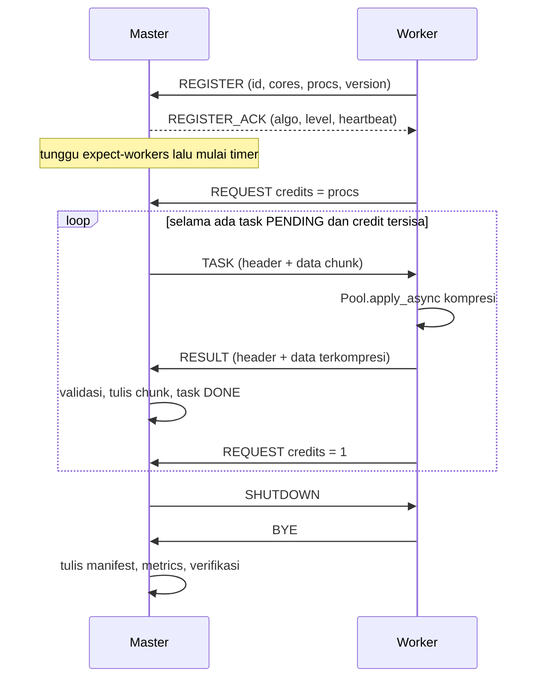
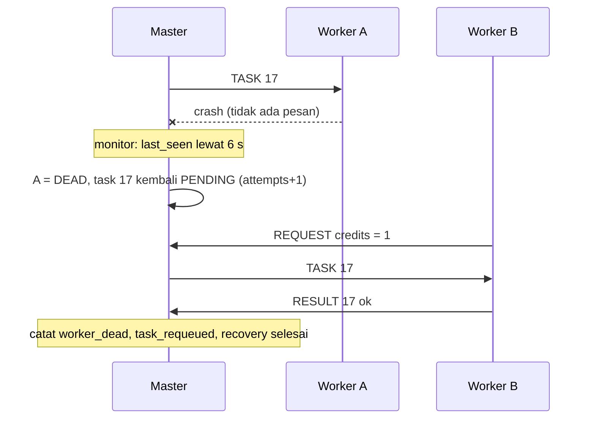
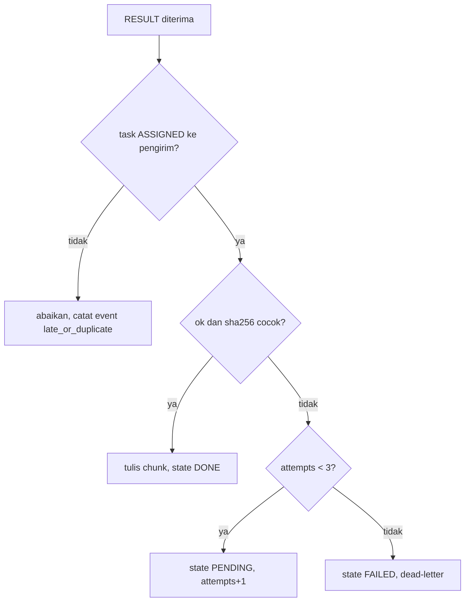
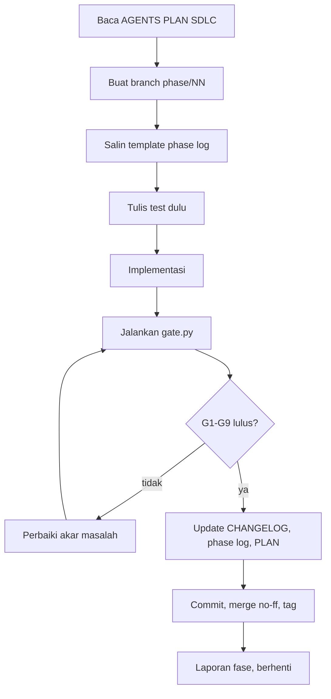

# FLOW.md — Alur Sistem dan Alur Kerja Agent

## 1. Startup dan pemrosesan normal

## 2. Worker gagal

## 3. Keputusan di Master saat menerima RESULT

## 4. Alur eksperimen
1. Siapkan dataset dan `config/*.toml`. 2. Jalankan `check_node.py` di semua node. 3. Start Master dengan `--expect-workers n`. 4. Start n Worker. 5. Master menjalankan, menulis `results/raw/<exp>/<run_id>/`. 6. Jalankan `tools/verify.py`. 7. Ulangi 3 kali. 8. `bench/report.py` membuat ringkasan dan grafik.

## 5. Alur kerja AI agent per fase

